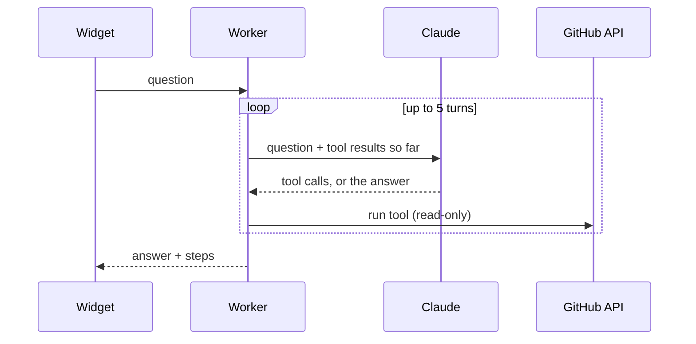

# agent-demo

An AI agent that answers questions about my work by calling tools on my GitHub. Runs on Cloudflare Workers with Claude. Each answer shows the tool calls behind it.

Live on [ackeskin.github.io](https://ackeskin.github.io).

## How it works



The loop is in `src/agent/loop.ts`: ask the model, run the tools it asks for, send the results back, repeat. On the last turn the tools are withheld, so the model has to answer. Tool errors go back to the model as results instead of failing the request.

### Tools

| Tool | Does |
| --- | --- |
| `list_repos` | My public, non-fork repos with language, stars, last push |
| `get_readme` | A repo's README, with images and HTML removed |
| `get_languages` | A repo's languages in percent |
| `get_recent_commits` | Last 1 to 10 commit messages |
| `get_private_work_summary` | Text about my day job and private repos that I reviewed |

All tools are read-only. Every repo argument is checked against my public repo list, so the agent can't be pointed at other accounts or at private repos.

## Private work without leaking it

The live agent never sees a private repo or a token with private access. Instead:

1. `npm run summarize-private` runs on my machine with my own token. It keeps only languages, a detected stack (Unity, CMake, well-known libraries) and years. No names, descriptions, file paths or code.
2. It writes `data/private-repos.draft.md`, which git ignores.
3. I edit it, then rename it to `data/private-repos.md`. Only reviewed files in `data/` are bundled.

`data/hololight.md` was written the same way from a work-history export.

## Cost and abuse controls

| Control | Where |
| --- | --- |
| API key stays in a Worker secret | `wrangler secret put` |
| Requests must come from a listed origin | `ALLOWED_ORIGINS` |
| 5 questions per minute per IP | `[[ratelimits]]` in `wrangler.toml` |
| At most 5 model calls per question, 600 tokens each | `src/worker/handler.ts` |
| Tool output cut to 4,000 characters | `src/agent/loop.ts` |
| GitHub responses cached for 10 minutes | `src/tools/github.ts` |
| Monthly spend limit | Set it in the Claude Console |

The origin check only keeps other websites from using the API, since a script can fake the header. The rate limit and the spend limit are what cap the bill.

## Run it

Needs Node 22.18 or later.

```sh
npm install
npm run check        # typecheck + tests
npm run build        # dist/ with an example run (no Worker needed)
```

Local Worker:

```sh
echo "ANTHROPIC_API_KEY=sk-ant-..." > .dev.vars
npm run dev
curl -X POST localhost:8787/api/ask -H 'origin: https://ackeskin.github.io' -H 'content-type: application/json' -d '{"question":"What graphics work has he done?"}'
```

## Deploy

1. `npx wrangler login`, then `npx wrangler secret put ANTHROPIC_API_KEY`. Optional: `npx wrangler secret put GITHUB_TOKEN` (no scopes needed) for a higher GitHub rate limit.
2. In the GitHub repo settings add variables `CLOUDFLARE_ACCOUNT_ID` and `WORKER_URL`, and secret `CLOUDFLARE_API_TOKEN` (Workers Scripts edit).
3. Set Pages source to GitHub Actions.

## Embed

```html
<div data-agent-demo data-endpoint="https://agent-demo.<you>.workers.dev"></div>
<script type="module" src="https://ackeskin.github.io/agent-demo/widget.js"></script>
```

## API

`POST /api/ask` with `{ "question": string }`

```json
{
  "answer": "His main graphics project is procedural-planets ...",
  "steps": [{ "tool": "get_readme", "input": { "repo": "procedural-planets" }, "ok": true, "preview": "..." }],
  "truncated": false
}
```

Errors: `400` bad input, `403` origin, `429` rate limited, `502` model unavailable.

## Layout

```
data/            Reviewed summaries bundled into the Worker
scripts/         build-data.ts, build-web.ts, summarize-private.ts
src/agent/       Agent loop, Claude client, system prompt
src/tools/       GitHub client and tool definitions
src/private/     Private repo summarizer (runs locally only)
src/worker/      Cloudflare Worker: routes, CORS, rate limit
src/web/         Chat widget with tool trace
test/            Vitest tests
```

## License

MIT
